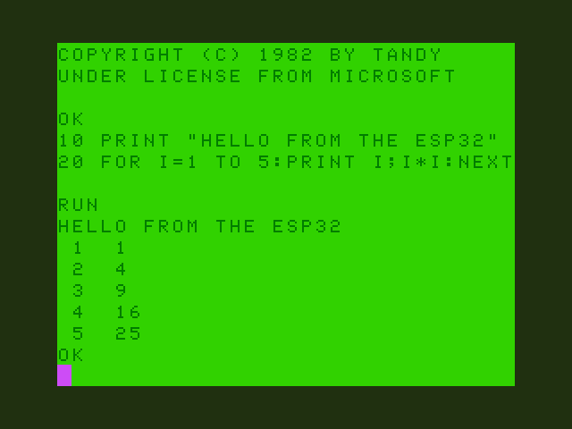
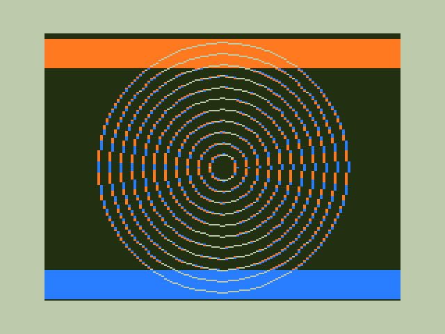
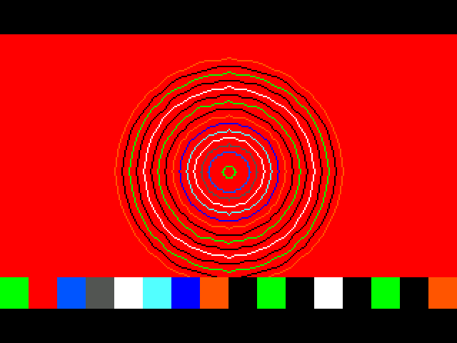
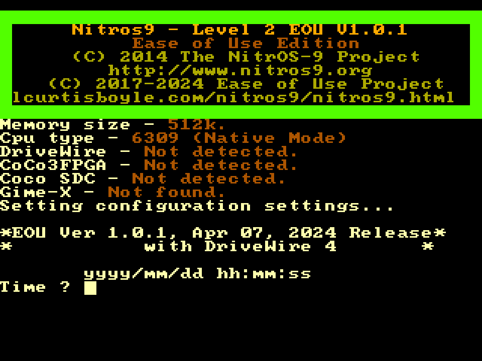
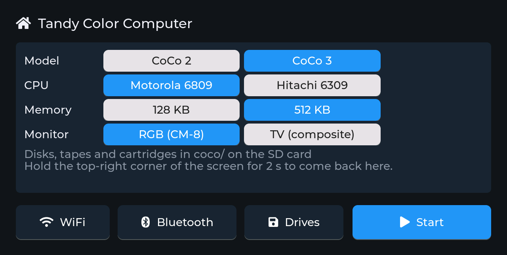
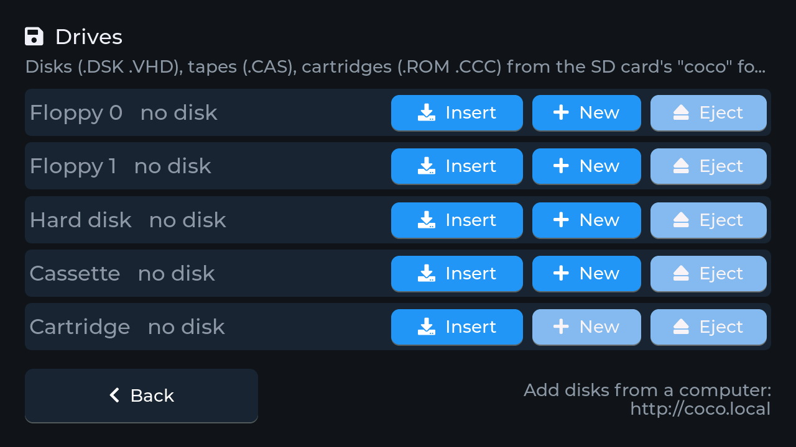
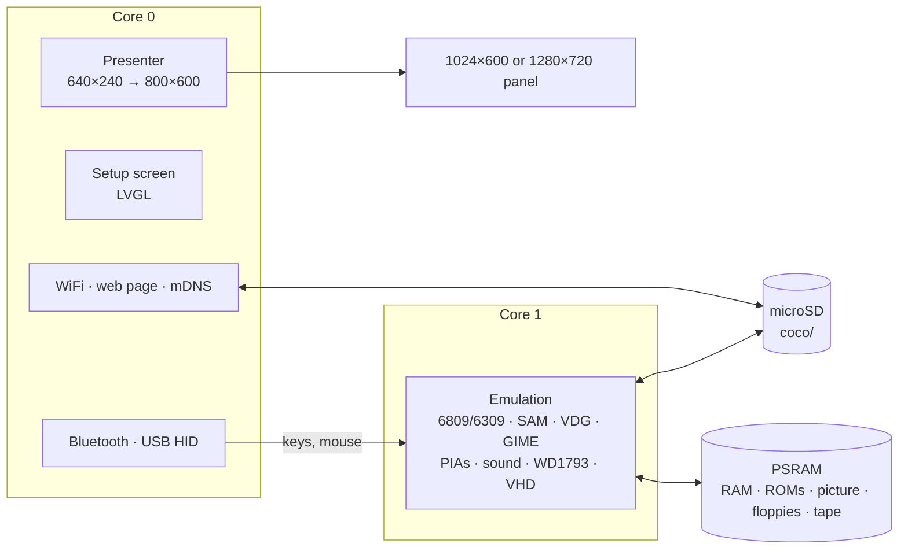

<h1 align="center">esp32coco</h1>

<p align="center">
  <b>A Tandy Color Computer 2 or 3 on a 7-inch ESP32-S3 touch-screen board or an M5Stack Tab5.</b><br>
  6809 or Hitachi 6309, the VDG and the GIME, cartridges, cassettes, floppies and an OS-9 hard disk, Bluetooth and USB keyboards.
</p>

<p align="center">
  
  
  
  
  
  
</p>

<p align="center">
  <b>Work in progress:</b> not everything has been tested, and games and demos may or may not
  work satisfactorily.
</p>

<p align="center">
  
  
  <br>
  
  
  <br>
  <sub>Extended Color BASIC on the CoCo 2; PMODE 4 with its artifact colours; the CoCo 3's
  320×192 screen in 16 colours; NitrOS-9 starting from the hard disk on a CoCo 3 with a
  6309 (on the Tab5's panel). Borders included.</sub>
</p>

esp32coco turns the Makerfabs MaTouch ESP32-S3 Parallel TFT with Touch 7", or
an M5Stack Tab5, into a Tandy Color Computer 2 or 3. The picture, border
included, fills the panel's height at the shape a TV gave it; a Bluetooth
keyboard (or, on the Tab5, a USB one) works the CoCo, and cartridges, tapes,
floppies and an OS-9 hard disk come from the microSD card. A setup screen on
the touch panel, and a web page on your network, handle everything else.

It's the sibling of [esp32ste](https://github.com/rlucencic/esp32ste) (Atari
STE), [esp32mac](https://github.com/rlucencic/esp32mac) (Macintosh Plus, SE,
Classic), [esp32mac2](https://github.com/rlucencic/esp32mac2) (Macintosh LC
and II), [esp32mac3](https://github.com/rlucencic/esp32mac3) (Macintosh LC II
and LC III), [esp32cpc](https://github.com/rlucencic/esp32cpc) (Amstrad CPC),
[esp32zx](https://github.com/rlucencic/esp32zx) (ZX Spectrum),
[esp32cbm](https://github.com/rlucencic/esp32cbm) (Commodore 64 and 128),
[esp32xl](https://github.com/rlucencic/esp32xl) (Atari 800XL and 130XE),
[esp32msx](https://github.com/rlucencic/esp32msx) (MSX1 and MSX2) and
[esp32gs](https://github.com/rlucencic/esp32gs) (Apple IIGS); all are built on
the shared runtime [esp32emu](https://github.com/rlucencic/esp32emu), which
also holds this one's 6809 and 6309 core.

## Features

**The machines**
- **Color Computer 2**: 64 KB, Color BASIC with Extended BASIC, at 0.89 MHz
  (1.79 MHz with the "speed-up poke")
- **Color Computer 3**: 128 or 512 KB, its own BASIC, 0.89 or 1.79 MHz
- **Motorola 6809 or Hitachi 6309**, chosen on the setup screen, as the
  6309 was fitted to many CoCos: in emulation mode it runs what a 6809
  does; software that knows it (NitrOS-9's 6309 version, programs that
  switch it to native mode) gets its extra registers (E, F, W, Q, V, MD),
  its instructions (register-to-register arithmetic, TFM block moves, bit
  operations, DIVD, DIVQ, MULD and the rest), its traps and its faster
  native mode. Both from one core with desktop conformance tests.

**The picture**
- **MC6847 VDG** (CoCo 2): text with its look (dark on green, inverse lower
  case), the semigraphics modes, all eight graphics modes up to PMODE 4, and
  PMODE 4's **artifact colours** as a TV shows them, in either phase or off;
  the SAM's video counter, so the semigraphics tricks that depend on it work
- **GIME** (CoCo 3): 32, 40, 64 and 80-column text with colour attributes,
  underline and blinking; graphics from 128×192 to 640×225 in 2, 4 or 16
  colours of 64; 192, 200 and 225 lines; horizontal and vertical scrolling;
  the palette on an **RGB monitor** (CM-8) or a **TV** (composite colours);
  the CoCo 2's modes through its palette (and lower case, as the MC6847T1
  it copies has it)
- **MMU** (CoCo 3): 8 KB blocks in two tasks, the ROM modes, constant RAM at
  `$FE00`; the GIME's timer and its interrupts (timer, borders, keyboard,
  cartridge), as IRQ or FIRQ

**Sound**: the 6-bit DAC and the single-bit sound, through the analogue
multiplexer as the CoCo has it (SOUND, PLAY, sampled sound, the tape's own
noise when you choose to hear it)

**Cartridges, tapes, disks**
- **Cartridges**: `.ROM`, `.CCC` and `.BIN` images up to 32 KB that start by
  themselves, as the real ones do through the CART line; or, in the same
  slot, the **disk controller** with Disk BASIC
- **Cassette**: `.CAS` tapes play into the cassette input as the tones they
  were (CLOAD and CLOADM read them as from a real tape), and **CSAVE** records
  onto them; fast loading runs the CoCo several times faster while the tape
  plays
- **Floppies**: two drives, a **WD1793** with Disk BASIC's HALT and NMI
  timing, `.DSK` images (JVC: RS-DOS and OS-9 disks, 35 or 40 tracks, one or
  two sides, 80 tracks), formatting with DSKINI, writes back to the image
- **Hard disk**: an SD-card image on the **VHD interface** that NitrOS-9's
  emulator driver (EmuDsk) uses: OS-9 runs from it, and writes go back to it
- **New blank media** from the setup screen or the web page: 156, 360 or
  720 KB floppies (formatted for Disk BASIC), a 32 MB hard disk, an empty
  tape

**Around it**
- **Setup screen** before the CoCo starts, and any time while it runs (hold
  the top-right corner for 2 seconds): WiFi, Bluetooth pairing, the model,
  CPU, memory and monitor, the five drives, reset
- **Keyboards**: Bluetooth (BLE HID) on both boards, **USB** keyboards and
  mice on the Tab5's USB-A port, the Tab5 Keyboard; the CoCo 3's ALT, CTRL,
  F1 and F2 on the PC's
- **Joystick**: a mouse, the touch screen or the numeric keypad move it
- **Web page** at `http://coco.local`: drop disk images, tapes, cartridges or
  `.ZIP` files onto it, put them into drives, make blank ones, and watch the
  machine, drives and board live
- **Sound** on the board's speaker (on the Tab5 by default, on the MaTouch
  optional, `menuconfig`)

## Hardware

| | Makerfabs MaTouch ESP32-S3 7" | M5Stack Tab5 |
|---|---|---|
| Chip | ESP32-S3-WROOM-1-N16R8: 16 MB flash, 8 MB octal PSRAM | ESP32-P4 (RISC-V, 360 MHz): 16 MB flash, 32 MB PSRAM; an ESP32-C6 for WiFi and Bluetooth |
| Screen | 7" 1024×600 RGB, GT911 capacitive touch | 5" 1280×720 MIPI-DSI, capacitive touch (either panel revision), held landscape |
| Storage | microSD card (FAT32 or exFAT) | microSD card (FAT32 or exFAT) |
| Input | any BLE keyboard and mouse | USB keyboards and mice on the USB-A port, any BLE keyboard and mouse, the Tab5 Keyboard |
| Sound | a speaker on the MAX98357A output (optional, `menuconfig`) | the built-in speaker (ES8388) |

The picture is 640×240: the 256×192 (or the CoCo 3's up to 640×225) picture
with its border, pixels doubled across. On the MaTouch it fills 800×600, on
the Tab5 960×720: the 4:3 of a TV. Both boards run either CoCo at full speed
(core 1 is at most about two thirds busy on the MaTouch, a third on the Tab5).

## Getting started

### 1. What you need

- [ESP-IDF](https://github.com/espressif/esp-idf) v5.5 (developed with v5.5.4)
- [esp32emu](https://github.com/rlucencic/esp32emu), checked out next to this project (`../esp32emu`)
- The ROM images in `roms/` (see [roms/README.md](roms/README.md)): Color BASIC and Extended BASIC for the CoCo 2, `coco3.rom` for the CoCo 3, and Disk BASIC for the floppies
- A microSD card, FAT32 or exFAT
- For OS-9: [NitrOS-9 Ease of Use](https://www.lcurtisboyle.com/nitros9/nitros9.html), whose emulator set (a boot floppy and a hard disk) runs as it is

### 2. Build and flash

```sh
git clone https://github.com/rlucencic/esp32emu.git     # the shared runtime, next to it
git clone https://github.com/rlucencic/esp32coco.git && cd esp32coco
idf.py build
idf.py -p /dev/cu.usbmodem… flash      # app and the ROM images

# or for the M5Stack Tab5 (its own build folder and settings):
idf.py -B build-tab5 -DIDF_TARGET=esp32p4 -DSDKCONFIG=build-tab5/sdkconfig build
idf.py -B build-tab5 -DIDF_TARGET=esp32p4 -DSDKCONFIG=build-tab5/sdkconfig -p /dev/cu.usbmodem… flash
```

Later updates only need `idf.py -p … app-flash`. Instead of flashing the
ROMs, you can also copy them into a `coco/roms` folder on the SD card.

### 3. First start

1. The board starts on the **setup screen**. Tap **WiFi** to join your
   network: the web page becomes reachable.
2. Tap **Bluetooth** to pair a keyboard (on the Tab5, a USB keyboard works
   as soon as it's plugged in).
3. Choose the **model**, **CPU**, **memory** and **monitor**, then tap **Start**:
   Color BASIC's `OK`.
4. Open `http://coco.local` and drop a disk image, tape or cartridge onto
   the page, then **Insert into…** a drive.

<p align="center">
  
  <br><sub>The setup screen on the Tab5, with the CoCo 3, a 6809, 512 KB and the RGB monitor chosen (its status lines left out)</sub>
</p>

## Using it

| To | Do |
|---|---|
| Get back to the setup screen | Hold the top-right corner of the screen for 2 s |
| Change the model, CPU or memory | On the setup screen; **Restart** applies it |
| Change the monitor (CoCo 3) or the artifact colours (CoCo 2) | On the setup screen; at once |
| Reset | F5 (the reset button), or **Reset** on the setup screen (power off and on) |
| Use a floppy | Insert it into **Floppy 0** or **1**, then `DIR`, `LOAD "NAME"`, `RUN "NAME"`; `DSKINI0` formats one |
| Boot OS-9 | NitrOS-9 EOU's `68EMU.DSK` (or `63EMU.DSK` with the 6309) in **Floppy 0** and its `.VHD` in **Hard disk**, CoCo 3 with 512 KB, then `DOS` |
| Load from a tape | Insert it into **Cassette**, then `CLOAD` (or `CLOADM` and `EXEC`) |
| Save to a tape | **New** next to **Cassette** (an empty tape), then `CSAVE "NAME"`; rewind it with the console's `w` or by inserting it again |
| Run a cartridge | Insert it into **Cartridge**: the CoCo starts again and runs it; eject it to get the disk controller back |
| Make new media | **New** next to a drive on the drives page, or on the web page |
| Copy files from a computer | Drop them onto the web page (ZIP files are unpacked), or `curl -T game.dsk http://coco.local/disks/` |

Everything lives in the `coco` folder on the SD card. The inserted media
are remembered across restarts.

<p align="center">
  
</p>

**Keyboard**: letters by position; digits and symbols by the character they
give on a US keyboard, with SHIFT as the CoCo needs it (Shift+' is ", which
is SHIFT+2 on the CoCo). Return is ENTER, Backspace and the cursor keys the
arrows, Esc or Pause BREAK, Home CLEAR, Caps Lock SHIFT+0 (the CoCo's
upper/lower case). Ctrl, Alt, F1 and F2 are the CoCo 3's CTRL, ALT, F1 and
F2. F5 is the reset button.

**Joystick**: the mouse moves it (the CoCo's own mouse was a joystick), its
buttons are the joystick's; touching the picture puts it there with the
button down; the numeric keypad (8 4 6 2 and the diagonals, 0 or 5 the
button) pushes it to the edges. F11 switches between the right and the left
joystick.

## Configuration

`idf.py menuconfig` → **Emulator board**:

| Option | Default | |
|---|---|---|
| WiFi, setup screen | on | Time zone for the clock (POSIX TZ) |
| Start by itself | off | Countdown on the setup screen |
| Web page, network name | on, `coco` | `http://<name>.local` |
| BLE keyboard and mouse | on | |
| USB keyboard and mouse | on (Tab5) | |
| Sound on the speaker | off (Tab5: on) | Volume; moves the MaTouch's console to the UART port |

## How it works



- **`components/coco`**: the CoCo 2 and 3, platform independent, one folder
  for each part (`cpu`, `memory`, `sam`, `vdg`, `gime`, `pia`, `keyboard`,
  `joystick`, `sound`, `cartridge`, `cassette`, `fdc`, `harddisk`). It also
  builds on a desktop (`components/coco/host`) for testing with scripted
  typing, joysticks and media, screenshots, sound recording and CPU traces.
- **`main`**: the CoCo on the board: memory, ROMs, settings, the keyboard
  map, the joystick, the drives and status.
- **[esp32emu](https://github.com/rlucencic/esp32emu)**: the board runtime
  and the 6809/6309 core.

A frame is 262 scan lines of 63.5 µs (57 CPU cycles at 0.89 MHz, 114 at 1.79
MHz). Time is kept in ticks of the 3.58 MHz colour carrier, so the timer,
the disk drive, the cassette and the sound keep real time at either CPU
rate. The CPU runs a line at a time, stopping early for the disk
controller's bytes and the GIME's timer. At the end of each line the VDG or
the GIME draws it; a line that comes out the same as last frame isn't copied
again.

## Development

```sh
make -C components/coco/host                                        # desktop build of the core
components/coco/host/build/coco_host 2 300 coco2.ppm                # a CoCo 2 for 300 frames
COCO_CPU=6309 COCO_FLOPPY0=63EMU.DSK COCO_HD=63SDC.VHD \
  COCO_SCRIPT=os9.txt components/coco/host/build/coco_host 3 6000    # OS-9 with a script
make -C ../esp32emu/components/m6809/test test                      # the 6809 and 6309 tests

python ../esp32emu/tools/emu_console.py /dev/cu.usbmodem… lcd screen.png         # the panel
python ../esp32emu/tools/emu_console.py /dev/cu.usbmodem… send 'T PRINT 1\n'     # type on the CoCo
python ../esp32emu/tools/emu_console.py /dev/cu.usbmodem… profile build/esp32coco.elf  # where the time goes
curl http://coco.local/api/status                                                # live status as JSON
```

`CLAUDE.md` has the details: architecture, timing, the media, debugging
options and the lessons learned along the way.

## Limitations

- New. Checked on both boards: Color BASIC and Disk BASIC, the graphics
  modes, saving and loading on floppies and tapes, NitrOS-9 (6809 and 6309)
  from the hard disk, the setup screen and the drives page. Not tried by
  hand yet: the sound by ear, Bluetooth and USB keyboards, the mouse and
  touch as the joystick, the Tab5 Keyboard. **Games and other software
  haven't been tried yet**; no commercial cartridges (only a test one).
- The cartridge slot holds a ROM cartridge or the disk controller, not
  both (there's no Multi-Pak).
- Floppy images are JVC (`.DSK`, `.OS9`): no `.DMK` or `.VDK`, no copy
  protection; reading a whole track gives its sectors' data without gaps.
- The floppy drive is faster than a real one (2 ms a track, no turning to
  the sector).
- Each line is drawn with the video registers as they are at its end: a
  change in the middle of a line (palette, mode) shows on the whole line.
  The CoCo 3's composite colours and the artifact colours are
  approximations; the 6847's "stripes" mode is as MAME has it.
- No RS-232, printer, DriveWire, Orchestra-90 or the 2 MB and 8 MB memory
  upgrades.
- The GIME's text characters are the public domain font8x8, not the GIME's
  own; the VDG's are a 5×7 font drawn for this project in its style.

## Credits

- [MAME](https://www.mamedev.org)'s CoCo drivers (Nathan Woods and others,
  BSD-3-Clause): the reference for the SAM's video counter, the VDG, the
  GIME, the disk controller's lines and the VHD interface
- Kevin Darling's and Sock Master's GIME references, *Color Basic
  Unravelled* and *Disk Basic Unravelled*
- [font8x8](https://github.com/dhepper/font8x8) (Daniel Hepper, after IBM's
  and Marcel Sondaar's; public domain) for the GIME's text
- [NitrOS-9](https://github.com/nitros9project/nitros9) and its
  [Ease of Use](https://www.lcurtisboyle.com/nitros9/nitros9.html) edition,
  used for testing (not included)
- [LVGL](https://lvgl.io) for the setup screen
- [ESP-IDF](https://github.com/espressif/esp-idf), NimBLE and the USB host
  HID driver

## Licence

[MIT](LICENSE). LVGL (MIT) and ESP-IDF (Apache 2.0) are fetched at build time
and keep their own licences.

Tandy, Color Computer and TRS-80 are trademarks of their owners. The ROM
images are not part of this repository.
